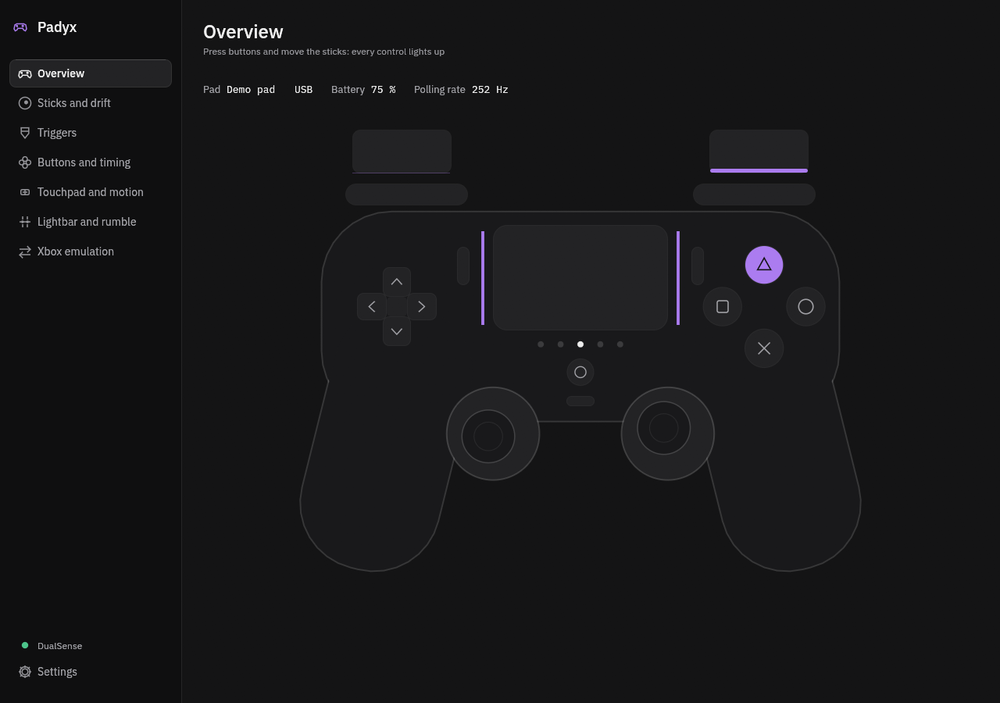
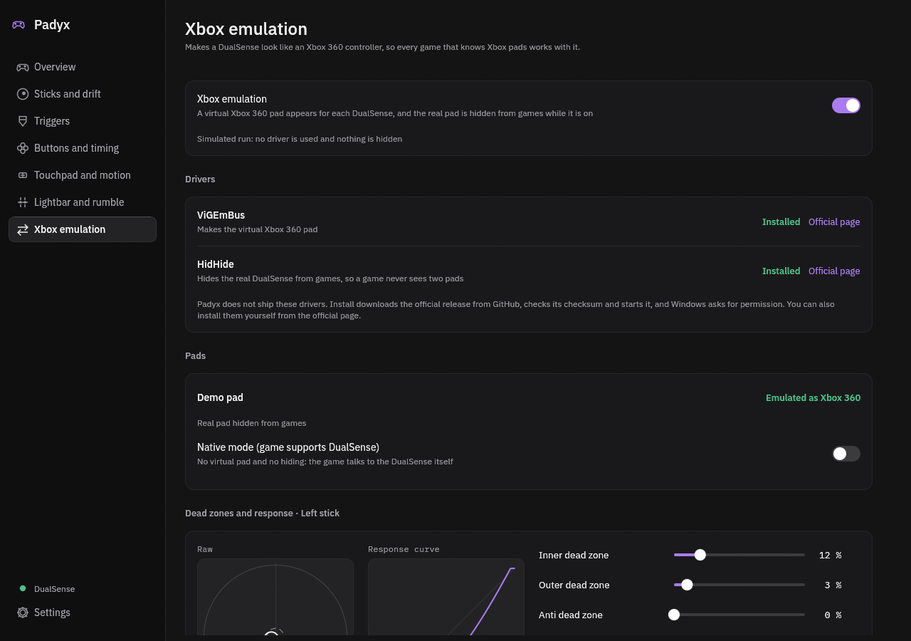
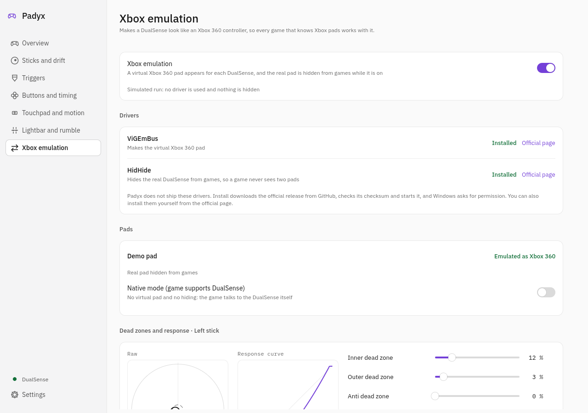
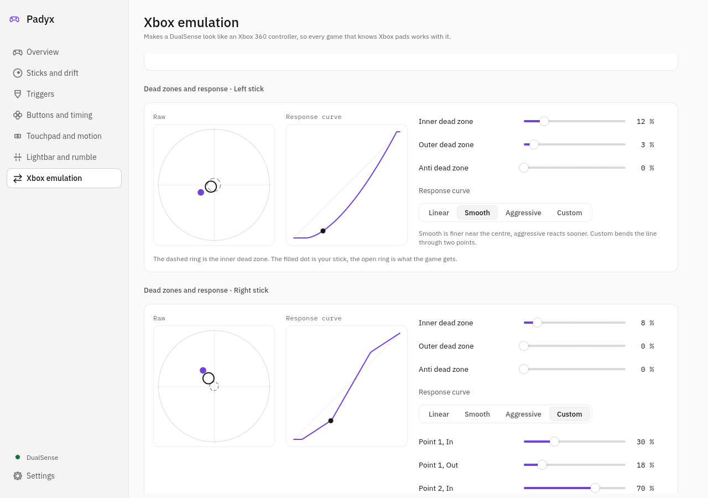

# Padyx

A DualSense tester and helper for Windows and Linux. It shows every control of a PlayStation DualSense live, finds stick drift, sets the lightbar, player LEDs, rumble and adaptive triggers, and makes the pad look like an Xbox 360 controller so games outside Steam see it.

> Status: the tester, the pad setup and the Xbox controller mode (ViGEmBus and HidHide on Windows, uinput on Linux, dead zones, curves, rumble) are done. Remapping, macros, turbo and per-game profiles are added in the same 1.0.0 and are described here when they land.



## What it does

- **Overview.** A drawn DualSense lights up as you press it. Triggers fill by value, sticks show their position, the touchpad shows both fingers. Connection (USB or Bluetooth), battery and the measured polling rate are always on top.
- **Sticks and drift.** A large plot per stick with its trail and the 5 % and 10 % rings. A five second no-touch drift test gives the resting offset and jitter with a verdict. A circularity test shows the outer shape of the travel and its average error.
- **Triggers.** Live values and a test of the adaptive effects (resistance, weapon, vibration).
- **Buttons and timing.** A checklist of 17 controls that tick as you press them, and the interval between reports with its jitter.
- **Touchpad and motion.** The touchpad surface with two fingers, the gyroscope and accelerometer (with the calibration read from the pad) and a small orientation glyph.
- **Lightbar and rumble.** The NIMVORO palette or a custom RGB colour, brightness, player LEDs, the mute button light and both rumble motors. The colour is saved and applied every time the pad connects.
- **Xbox emulation.** A virtual Xbox 360 pad for every DualSense, with the real pad hidden from games while it is on. Dead zones (inner, outer and anti), response curves, trigger dead zones, the touchpad click and Mute as extra buttons, and the strength of the rumble games send back. A per-pad native mode for games that know the DualSense. See below.
- **Settings.** Language (English, Russian, Ukrainian), theme, start with the computer (off by default), updates and about.

Padyx has two parts in one program: a small background part that reads the pad and keeps the tray icon (it draws nothing), and the window, which starts when you open Padyx and closes completely when you close it.

## Xbox emulation

Many games outside Steam only know Xbox controllers. With the emulation on, Padyx creates a virtual Xbox 360 pad for each DualSense and feeds it from the real one, so the game just sees an Xbox pad.








- **Mapping.** By position: Cross is A, Circle is B, Square is X, Triangle is Y, Create is View (Back), Options is Menu (Start), PS is Guide, L1/R1 are LB/RB, L3/R3 are the stick clicks, the D-pad is the D-pad, and the triggers are the triggers. The touchpad click is View by default and can be any Xbox button; Mute is unmapped by default and can be set too.
- **Dead zones and curves**, per stick: an inner dead zone that is round (not per axis), an outer one, and an anti dead zone that jumps over a game's own inner zone. The response curve is linear, smooth, aggressive, or custom with two points. The page shows the stick before and after, live, and the same rings on the "Sticks and drift" page while the emulation is on. Each trigger has an inner and an outer dead zone.
- **Rumble.** What a game sets through XInput goes to the DualSense motors, with an intensity slider.
- **Native mode**, per pad: no virtual pad and no hiding, for games that support the DualSense themselves.
- **Hiding the real pad.** While the emulation is on, the real DualSense is hidden from games (HidHide on Windows, an exclusive grab of its input devices on Linux), so a game never sees two pads. The pad is given back when the emulation is turned off, when Padyx exits, and at the next start if a run crashed. Settings and the emulation page have a **Restore pad visibility** button that turns the emulation off and undoes everything.
- **Tray.** The tooltip shows the battery, there is a low battery notice at 15 %, the menu has an Xbox emulation switch, and the icon is dimmed while the emulation is off.
- **Light on the machine.** With the window closed, the background part reads the pad and maps it with no queue and no polling sleeps; the CPU and memory numbers are in the notes below.

### Drivers (Windows)

The emulation needs two free drivers by Nefarius Software Solutions. Padyx ships neither:

| Driver | What it does | Official page |
|---|---|---|
| ViGEmBus 1.22.0 | Makes the virtual Xbox 360 pad | https://github.com/nefarius/ViGEmBus/releases/tag/v1.22.0 |
| HidHide 1.5.230 | Hides the real DualSense from games | https://github.com/nefarius/HidHide/releases/tag/v1.5.230.0 |

The **Install** button on the Xbox emulation page downloads the official installer from that GitHub release, checks it against a SHA-256 that is built into Padyx, and only then starts it; Windows asks for permission, because only the installer runs with administrator rights, never Padyx. If the checksum does not match, the file is deleted and nothing runs. You can also install both yourself from the pages above. HidHide asks for a restart after it installs. Without HidHide the emulation still works, but games may see both the real and the virtual pad.

The built-in checksums are the `InstallerSha256` values of the winget manifests of these two files:

- ViGEmBus: `89220a7865076b342892f98865f3499fb7c4cfd673159e89d352c360fd014c6a`
- HidHide: `f4bbbcb82e6258641b887c74bc81c4c5f66e4aa811808dfc304347687b7605f6`

### Linux

- The virtual pad comes from **uinput** and looks like the kernel's own Xbox 360 pad (vendor `045e`, product `028e`, the `xpad` buttons and axes, force feedback of the rumble type), so SDL, Steam Input and Proton map it with no setup. It needs `/dev/uinput`: load the module with `sudo modprobe uinput` if it is missing. The udev rule that Padyx installs for the tester (one `pkexec` prompt) also gives your user access to `/dev/uinput` and to the pad's input devices.
- To hide the real pad, Padyx grabs its evdev nodes (`EVIOCGRAB`) while the emulation is on and lets go when it stops; the kernel also releases a grab if Padyx dies. A program that reads the DualSense through hidraw (Steam does) can still see it: use the native mode for such games.
- Wayland and X11 both work; the emulation does not use the display.

## Pads

| Pad | Connection | State |
|---|---|---|
| DualSense | USB, Bluetooth | supported, the target |
| DualShock 4 | USB, Bluetooth | parsed (sticks, buttons, triggers, motion, battery), **untested** |

Over Bluetooth a DualSense starts in a reduced mode with few fields. Padyx reads the pad's calibration report, which switches it to the full report, and writes output reports with the CRC32 the pad requires.

## Linux

- Padyx reads the pad through hidraw. The kernel's `hid-playstation` driver stays bound, and for the lightbar Padyx prefers the kernel LED class (`/sys/class/leds/*:rgb:indicator`), so the two do not fight.
- A normal user may not open hidraw devices. On the first run, if a pad is there but cannot be opened, Padyx shows one screen that explains this and offers to install a udev rule (`/etc/udev/rules.d/70-padyx.rules`, `TAG+="uaccess"` for the Sony devices) through `pkexec`. Nothing is installed without that prompt. The same step is in Settings.
- The tray icon needs GTK 3 and libayatana-appindicator3. GNOME also needs the AppIndicator extension.
- Build dependencies: `libgtk-3-dev libayatana-appindicator3-dev libxkbcommon-dev libwayland-dev libx11-dev libxcb1-dev libxdo-dev libudev-dev`.

## Numbers

Measured with the demo pad (250 reports a second, the sticks always moving, so every report changes the virtual pad), window closed, on the release build:

- Added latency of the emulation, from a parsed report to the virtual pad having it (find the pad, map, hand over): about 0.1 microseconds in the mapping and 6 to 8 microseconds in the ViGEmBus call (median), 45 microseconds at the 99th percentile; the reader thread does all of it, with no queue and no sleep in between. A change reaches XInput in about 11 microseconds (median) by a measurement from the call to XInput showing it.
- CPU and memory of the background part over five minutes (12 logical cores): with the emulation on, 1.1 % of one core on average (0.09 % of the machine, 2.5 % at most) and a 14.4 MB working set (3.4 MB private); with it off, 0.4 % of one core and 14.0 MB. The virtual pad is only updated when a report changes it.

## Build

```
cargo build --release
cargo test
```

On Windows the GNU and MSVC toolchains both work. `cargo test -- --ignored --test-threads=1` also runs the live checks against an installed ViGEmBus (a synthetic pad, never your own; they need the driver and are skipped without it). `Padyx --demo` runs the window with a scripted fake pad and no hardware (set `PADYX_DATA_DIR` to a temporary folder first). `Padyx --list` prints the Sony pads the system sees and exits; it only enumerates and never writes to a pad.

Environment variables for tests and screenshots: `PADYX_DATA_DIR`, `PADYX_DEMO=1`, `PADYX_DEMO_T` (start of the script, seconds), `PADYX_DEMO_HOLD=1` (freeze the script), `PADYX_LANG`, `PADYX_THEME`, `PADYX_EMU_MOCK=1` (a test folder only: a simulated emulation, no driver is used and nothing is hidden) and `PADYX_SCROLL` (scroll the pages, for screenshots). `tools/screenshots.ps1` drives the window through the pages and saves a PNG of each.

## Report layouts

The parsers and writers are written from the public descriptions of the reports (the Linux `hid-playstation` driver notes, SDL's PS5 and PS4 HIDAPI drivers, DS4Windows). The byte layouts are documented at the top of `src/pad/parse.rs` and `src/pad/output.rs`, and the tests use synthetic fixtures built from those layouts.

## Support

If Padyx is useful to you, you can support its development: https://donatello.to/MicsGame


## License

MIT, see [LICENSE](LICENSE). The IBM Plex fonts are under the SIL Open Font License, see `assets/fonts/OFL.txt`.
